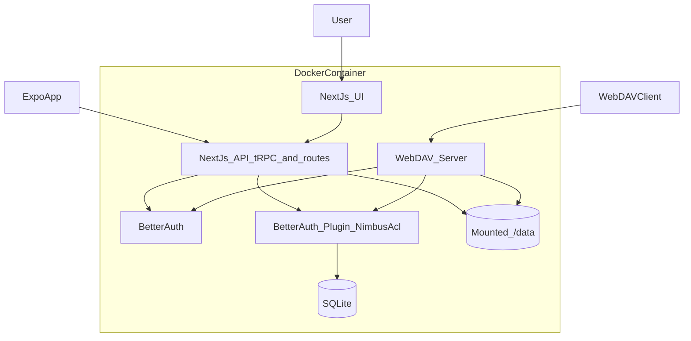

# Nimbus (Unified) — Self-Hosted Drive Architecture

## Product Goals

- Single Docker container deploy.
- Host serves whatever is present under mounted `/data` (filesystem is source of truth).
- Multi-user authentication and administration.
- Drive-like sharing:
  - internal sharing to users and groups/teams
  - allow-only path ACL with inheritance
- Public share links (optional password + expiry) with folder browsing + ZIP download.
- File previews/thumbnails (images, PDFs, video, text).
- Built-in WebDAV so users can mount as a drive on Windows/macOS.
- Web UI (desktop + mobile) and reuse APIs for a future Expo app.

## Recommended Tech Stack

- **Framework/UI**: Next.js (App Router) + React
- **Auth**: Better Auth
  - Admin plugin for user management and global admin actions
  - Nimbus ACL as a custom Better Auth plugin (schema + server helpers)
  - (Optional later) Organization plugin only if you want multi-tenant “workspaces”
- **Runtime/Tooling**: Bun (dev, build, and tests)
- **DB**: SQLite (single-file DB for simple self-hosting)
  - Optional later: Postgres
- **DB ORM**: Prisma or Drizzle (pick one; Prisma is common for Next.js)
- **API (DX)**: tRPC for metadata operations and UI workflows
- **Uploads**: tus (resumable) or chunked HTTP routes
- **Previews**:
  - Sharp for image thumbnails
  - pdf.js rendering for PDFs
  - video playback via HTTP range requests; optional thumbnails
- **Styling/UI**: Tailwind + shadcn/ui

## Core Architectural Principle

**Filesystem is the source of truth.** Nimbus reads the directory tree from `/data` every time (or with light caching). The DB stores:

- users/sessions (Better Auth)
- ACLs and groups/teams
- share link records
- trash records (soft-delete)
- optional preview cache metadata

## High-level Architecture

## Storage Layout in `/data`

- User content lives anywhere under `/data`.
- Nimbus-managed internal folders:
  - `/data/.nimbus/db.sqlite` (SQLite database; default location)
  - `/data/.nimbus/cache/thumbnails/`
  - `/data/.nimbus/cache/previews/` (optional)
  - `/data/.nimbus/uploads/` (tus temp)
  - `/data/.nimbus/trash/` (soft delete)

Nimbus should hide and deny access to `/data/.nimbus/**` from:

- file browsing/listing
- search
- share links
- WebDAV

## Authorization Model (Path ACL)

### Concepts

- **Subject**: user or group/team.
- **Resource**: a normalized path under `/data`.
- **Permission levels**:
  - `read`: list, download, preview
  - `write`: upload, create folder, rename/move, delete
  - `admin`: manage permissions and shares for that subtree
- **Inheritance**: permissions apply to subpaths by default.
- **Allow-only**: no explicit deny rules.

### Data ownership (implemented as a Better Auth plugin)

The ACL system is implemented as a **Better Auth plugin** that:

- Defines its own schema tables via the plugin `schema` feature.
- Exposes server-side helpers (e.g., `checkAccess(...)`) and/or typed plugin endpoints.

tRPC routes in the app call into the plugin server-side; the web UI and Expo app talk to tRPC.

### Recommended tables (owned by the Nimbus ACL plugin)

- `Group(id, name, createdByUserId, createdAt)`
- `GroupMember(groupId, userId, roleInGroup, createdAt)`
- `AclEntry(id, subjectType, subjectId, path, permission, createdByUserId, createdAt)`
- `ShareLink(id, token, path, isPublic, expiresAt, passwordHash?, createdByUserId, createdAt, downloadCount)`
- `TrashItem(id, originalPath, trashPath, deletedByUserId, deletedAt, expiresAt)`

### ACL Evaluation Rule

Given `(userId, path, requiredPermission)`:

- Determine subjects: the user + all groups they belong to.
- Find all ACL entries where:
  - subject matches
  - entry.path is a prefix of requested path
  - entry.permission satisfies required permission
- Select the best match by **longest-prefix path**.
- If no match: deny.

## Sharing

### Internal sharing (Drive-like)

- Sharing a folder/file to a user/group creates an `AclEntry`.
- “Shared with me” is derived: list ACL entries where subject includes user.

### Public share links

- Public links bypass internal ACL but are constrained to the shared path.
- **Default policy**: creating share links requires ACL `admin` permission on the path.
- Support:
  - folder browse UI
  - download folder as ZIP
  - optional password + expiry

## WebDAV (Built-in)

- Expose WebDAV endpoint (e.g. `/dav`).
- Auth options to decide later:
  - Better Auth session cookie (best for browser/WebDAV clients that support cookie is rare)
  - app-password/token (more realistic for WebDAV clients)
- Every WebDAV operation maps to FS ops and enforces ACL.
- Show all accessible roots (per your preference): shared-root (if enabled), per-user home, and shared paths.

## API Surface

### tRPC (recommended)

- `files.list(path)`
- `files.stat(path)`
- `files.searchFilename(query, root?)`
- `shares.create({path, isPublic, expiresAt?, password?})`
- `shares.revoke(token)`
- `acl.grant({subject, path, permission})` (calls Nimbus ACL plugin server-side)
- `acl.revoke(aclEntryId)` (calls Nimbus ACL plugin server-side)
- `groups.create(name)` (admin-only by default; calls Nimbus ACL plugin server-side)
- `groups.addMember(groupId, userId)` (admin-only by default; calls Nimbus ACL plugin server-side)
- `groups.removeMember(groupId, userId)` (admin-only by default)

### HTTP routes (recommended)

- `GET /api/files/`* download + directory listing (if not using tRPC for these)
- `POST /api/uploads/`* tus/chunked upload endpoints
- `GET /api/preview/`* thumbnails/previews
- `GET /s/{token}` public share view
- `GET /api/share/{token}/zip` folder zip download

## UI / Routes (suggested)

- `/files/`* file browser
- `/shares` manage share links
- `/shared-with-me` virtual view derived from ACLs
- `/admin/`* admin UI (user management, audits, system settings)

## Docker Deployment

- Container listens on `:3000` and is reverse-proxy agnostic.
- Mounts:
  - `/data` (your files + Nimbus internal state by default)

Defaults:

- SQLite DB path: `/data/.nimbus/db.sqlite`

Optional (advanced):

- Allow overriding DB path via env var (e.g. `NIMBUS_DB_PATH`) so users can put the DB on a separate volume like `/config/db.sqlite` if their `/data` storage is not SQLite-friendly.
- Use a Bun-based image (e.g. `oven/bun`) for runtime consistency with local tooling.

Example compose (conceptual):

- map `./data:/data`
- optionally map `./config:/config`

## Security Requirements

- Prevent path traversal (`..`, absolute paths).
- Decide symlink policy (recommended default: do not allow symlinks escaping `/data`).
- Rate limit auth + share endpoints.
- Audit log (optional): ACL changes, deletes, share creation.

## Implementation Roadmap (phased, but targets the end-state)

- Foundation: Next.js app, Better Auth, SQLite, basic layout.
- ACL engine + group model + permission UI.
- File browser: list/download/upload/rename/move/delete.
- Previews + thumbnail cache.
- Share links (public/internal) + folder browse + zip.
- WebDAV layer using same ACL checks.
- Polish: setup wizard, retention jobs (trash cleanup), docs.

## Open Questions to finalize next

- WebDAV auth: app-password/token vs another mechanism.
- Trash defaults: enabled by default, retention duration.
- Move/rename semantics across permission boundaries.

