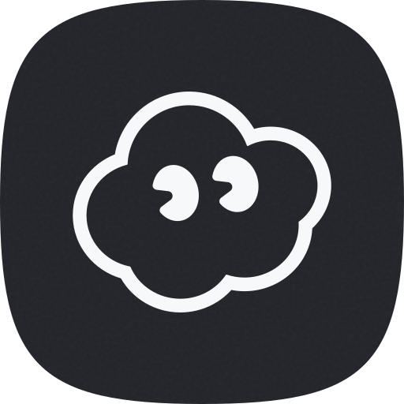

<p align="center">
  
</p>

<h1 align="center">Nimbus</h1>

<p align="center">A self-hosted file manager with account and group sharing, public download links, and WebDAV access.</p>

Files stay on your filesystem. Accounts, permissions, links, and preferences are stored in SQLite.

## Features

- Browse folders in list or grid views with sorting, breadcrumbs, and live updates.
- Upload files with resumable transfers, create folders, rename, move, download, and restore deleted items.
- Keep earlier versions of replaced files, and download or restore them.
- Install Nimbus as an app from supporting browsers.
- Preview images, PDF, audio, video, rendered Markdown, CSV and TSV tables, and syntax-highlighted code. Step through a folder with the arrow keys or by swiping. Edit text files in the browser. Download folders as ZIP archives.
- Thumbnails for images, PDFs, and videos in grid view and on public links.
- Search filenames as you type and keep starred and recently opened items.
- Share files and folders with existing users or groups using read, write, or sharing-management permissions.
- Create read-only public links with optional passwords, expiration, download limits, and a preview-only mode. Edit or revoke them later.
- Request files: share an upload link so people without an account can add files to a folder without seeing its contents.
- Manage users, groups, account roles, disabled accounts, and password resets from Settings → Administration.
- Connect WebDAV clients with individually revocable app passwords.
- Connect AI assistants over MCP, approved in the browser and revocable per client.
- Choose built-in light and dark themes, import VS Code themes, or find community themes on Open VSX.

## Local setup

Use Bun 1.4.4, the version the repository pins. Upgrading Bun is a deliberate change made in three places: `packageManager` in the root `package.json`, `bun-version` in `.github/workflows`, and the `oven/bun` tag and digest in the `Dockerfile`. Run these commands from the repository root:

```bash
bun install --frozen-lockfile
bun run setup
bun dev
```

Open [http://localhost:3000/signup](http://localhost:3000/signup) and create the first account. It becomes the server administrator. Public registration closes after that account is created. Add other accounts from **Settings → Administration → Users & groups**. Each account gets its own home folder; share other folders with them as needed.

`bun run setup` generates `apps/web/.env` with a random auth secret and creates a local data directory. It preserves an existing `.env`. Database migrations run before the server accepts requests.

## Docker deployment

The included Compose configuration builds Nimbus locally and persists files in `nimbus-data` and application state in `nimbus-config`. Docker Engine with Compose is required.

From the repository root, create a `.env` file for Compose containing:

```dotenv
BETTER_AUTH_SECRET=REPLACE_WITH_RANDOM_SECRET
BETTER_AUTH_URL=http://localhost:3000
```

Generate the secret with `openssl rand -base64 32` and paste its output as the value. Keep this file private and keep the same secret across restarts. Compose passes the auth settings, `PUID`, `PGID`, and `UMASK` to the container. To use other settings from [Configuration](#configuration), such as SMTP, single sign-on, or `NIMBUS_TRUSTED_PROXIES`, add them under `environment` in `compose.yaml`.

```bash
docker compose up -d --build
docker compose logs -f nimbus
```

Open [http://localhost:3000/signup](http://localhost:3000/signup) to create the administrator. Compose binds port 3000 to the host's loopback interface. For remote access, put an HTTPS reverse proxy in front of it and set `BETTER_AUTH_URL` to the public origin, for example `https://files.example.com`. The proxy must preserve the request host and forwarded protocol, allow WebDAV methods, and permit your intended upload sizes and transfer durations. Disable buffering for the live event stream. Serve Nimbus at the origin root, not under a URL prefix.

### HTTPS reverse proxy

Nimbus speaks plain HTTP/1.1 and expects a reverse proxy in front of it to provide HTTPS, which browsers require for passkeys. Speak HTTP/1.1 to Nimbus; HTTP/2 or HTTP/3 towards browsers is fine but not needed for speed, since the file browser's first visit loads about 30 scripts and fits in the six connections browsers open over HTTP/1.1. Nimbus already compresses its files, so leave compression off in the proxy, and do not buffer uploads or the live event stream.

[Caddy](https://caddyserver.com) does all of this by default:

```caddyfile
files.example.com {
	reverse_proxy 127.0.0.1:3000 {
		transport http {
			versions 1.1
		}
	}
}
```

nginx needs the buffering and size limits lifted:

```nginx
server {
    listen 443 ssl;
    http2 on;
    server_name files.example.com;
    ssl_certificate /path/fullchain.pem;
    ssl_certificate_key /path/privkey.pem;

    client_max_body_size 0;
    client_body_timeout 1h;
    gzip off;

    location / {
        proxy_pass http://127.0.0.1:3000;
        proxy_http_version 1.1;
        proxy_set_header Connection "";
        proxy_set_header Host $http_host;
        proxy_set_header X-Forwarded-Proto $scheme;
        proxy_set_header X-Forwarded-For $proxy_add_x_forwarded_for;
        proxy_buffering off;
        proxy_request_buffering off;
        proxy_read_timeout 1h;
        proxy_send_timeout 1h;
    }
}
```

Set `NIMBUS_TRUSTED_PROXIES` to the proxy's address so rate limits and the audit log see each visitor's address; see [Reverse proxies and client addresses](#reverse-proxies-and-client-addresses).

The server runs as an unprivileged user, by default UID and GID 1000. Set `PUID` and `PGID` to the numeric owner of your host directories, and Nimbus creates files as that user. `UMASK` (default `022`) sets the permissions of new files; `002` makes them group-writable. The container starts as root only to apply these settings, then drops privileges before the server starts. At startup it takes ownership of the config root and the reserved `/data/.nimbus` folder, which contain only Nimbus state, and of the `/data` directory itself; it never changes the ownership of your files. If you start the container with `--user` instead, these variables are ignored and the mounts must already be writable by that user. Persist both `/data` (managed files, trash, upload staging) and `/config` (database and thumbnail cache). Use one Nimbus process per data root, on a local filesystem. Locks, live events, and mutation coordination are maintained within that process.

### Published image

The Docker workflow builds the Dockerfile for `linux/amd64` and `linux/arm64` on native runners for every PR, without publishing. Pushes to `main` and version tags such as `v1.2.3` publish a multi-platform image to GitHub Container Registry with signed build provenance. Each Bun stage uses the `oven/bun:1.4.4` base image pinned by its multi-platform digest.

- `ghcr.io/augusdogus/nimbus:1.2.3` is published from the `v1.2.3` tag.
- `ghcr.io/augusdogus/nimbus:latest` tracks the most recently published stable release.
- `ghcr.io/augusdogus/nimbus:edge` tracks builds from `main` for testing unreleased changes.
- Prerelease tags such as `v1.3.0-beta.1` publish `:1.3.0-beta.1` without updating `:latest`.

To use a published image, replace `build: .` in `compose.yaml` with `image: ghcr.io/augusdogus/nimbus:latest`, keeping the environment and both volume mappings. Then run:

```bash
docker compose pull
docker compose up -d --no-build
```

Publishing uses the workflow's `GITHUB_TOKEN`; no registry secret needs to be configured. After the first publish, the package owner should set its visibility to **Public** in GitHub's package settings to allow pulls without signing in. New GHCR packages default to private. See [GitHub's registry documentation](https://docs.github.com/en/packages/working-with-a-github-packages-registry/working-with-the-container-registry).

### Unraid

Set `PUID=99` and `PGID=100`, Unraid's `nobody:users` owner for shares, so files created by Nimbus are accessible over SMB and to other containers. Use these container path mappings:

| Host path | Container path | Access |
| --- | --- | --- |
| `/mnt/user/data` | `/data` | Read/write |
| `/mnt/user/appdata/nimbus` | `/config` | Read/write |

Keep the appdata share on your SSD pool. `/mnt/cache/appdata/nimbus` can replace the appdata host path when `cache` is your pool name and the directory resides entirely there. For SSD uploads followed by HDD storage, configure the `data` share with the SSD pool as primary storage, the array as secondary storage, and Mover set from pool to array.

Keep `.nimbus/uploads` and `.nimbus/trash` inside the single `/data` mount. Separate mounts can prevent same-filesystem operations, even when their host paths reside on the same disk. Unraid controls physical placement; Nimbus does not move files between the cache pool and array. Existing installations should follow [Storage migration](#storage-migration) before switching to `/config`.

## Run without Docker

```bash
bun install --frozen-lockfile
bun run setup
bun run build
bun run start
```

Set the deployment values in `apps/web/.env` before startup. For PDF and video thumbnails, install Poppler's `pdftoppm` and `ffmpeg` (for example `apt install poppler-utils ffmpeg`); without them those files show generic icons. The Docker image includes both. `bun run build` builds the browser app into `apps/web/dist`; `bun run start` runs one Bun process that applies migrations, serves that app, the API, and WebDAV, and schedules retention cleanup. The process listens on all interfaces; put your service manager and HTTPS proxy in front of it as appropriate.

## Configuration

| Variable                      | Purpose                                                                                                                             |
| ----------------------------- | ----------------------------------------------------------------------------------------------------------------------------------- |
| `BETTER_AUTH_SECRET`          | Required random secret of at least 32 characters. Protect it and keep it across restarts.                                           |
| `BETTER_AUTH_URL`             | Public origin, including scheme and port when needed. Defaults locally to `http://localhost:3000`.                                  |
| `BETTER_AUTH_TRUSTED_ORIGINS` | Optional comma-separated additional trusted origins. Compose defaults this to `BETTER_AUTH_URL`.                                    |
| `NIMBUS_DATA_ROOT`            | Filesystem directory to manage. Local default: `apps/web/data` when launched with the supplied scripts. Container default: `/data`. |
| `NIMBUS_CONFIG_ROOT`          | Database and thumbnail cache directory. Local default: `<data root>/.nimbus`. Container default: `/config`. |
| `NIMBUS_HOMES_PATH`           | Folder inside the data root that holds every account's home folder, relative to the data root, for example `users` or `team/users`. Default `users`. See [Home folders](#home-folders). |
| `DATABASE_URL`                | Optional SQLite URL, overriding the config root for the database only. Default: `file:<config root>/db.sqlite`. Use an absolute path when overriding it. |
| `PORT`                        | Listening port, default `3000`. Update the public origin and proxy when changing it.                                                |
| `PUID`, `PGID`                | Container only. Numeric user and group the server runs as, default `1000`. |
| `UMASK`                       | Container only. Permission mask for new files and folders, default `022`. |
| `NIMBUS_TRUSTED_PROXIES`      | Comma-separated addresses or CIDR ranges of your reverse proxies, for example `127.0.0.1, 172.16.0.0/12`. Unset means `X-Forwarded-For` is ignored. See [Reverse proxies and client addresses](#reverse-proxies-and-client-addresses). |
| `NIMBUS_AUDIT_RETENTION_DAYS` | Days to keep audit log entries, from 30 to 36500. Default `365`. |
| `NIMBUS_SMTP_HOST`            | SMTP server for password reset email. Email is off unless this and `NIMBUS_SMTP_FROM` are set. |
| `NIMBUS_SMTP_FROM`            | Sender address, for example `Nimbus <nimbus@example.com>`. |
| `NIMBUS_SMTP_SECURITY`        | `starttls` (default, required upgrade), `tls` (implicit TLS), or `plain` (unencrypted, local relays only). |
| `NIMBUS_SMTP_PORT`            | Default `465` for `tls`, otherwise `587`. |
| `NIMBUS_SMTP_USER`, `NIMBUS_SMTP_PASSWORD` | SMTP credentials. Set both, or neither for an unauthenticated relay. |
| `NIMBUS_OIDC_ISSUER`          | OpenID Connect issuer URL. Single sign-on is off unless this, `NIMBUS_OIDC_CLIENT_ID`, and `NIMBUS_OIDC_CLIENT_SECRET` are set. Nimbus reads `<issuer>/.well-known/openid-configuration`. |
| `NIMBUS_OIDC_CLIENT_ID`, `NIMBUS_OIDC_CLIENT_SECRET` | Client credentials registered with the provider. Register `<BETTER_AUTH_URL>/api/auth/callback/oidc` as the redirect URI. |
| `NIMBUS_OIDC_NAME`            | Provider name on the sign-in button, for example `Authentik`. Default `single sign-on`. |
| `NIMBUS_OIDC_AUTO_PROVISION`  | `true` lets provider identities without a Nimbus account create a member account. Default `false`. |
| `NIMBUS_OIDC_GROUPS_CLAIM`    | Optional ID token claim listing group names, for example `groups`. See [Single sign-on](#single-sign-on). |
| `NIMBUS_BACKUP_KEEP`          | Daily database backups to keep in `<config root>/backups`, default `7`. |
| `NIMBUS_MCP_ENABLED`          | Optional. `false` turns off the MCP server, its OAuth endpoints, and discovery documents. Default: `true`. Approved clients stay stored. |

Startup fails with a message naming the problem when an optional integration is only partly configured, so a typo cannot silently turn email or single sign-on off.

The reserved `<data root>/.nimbus` directory contains trash and temporary uploads. Without a separate config root, it also contains the database and thumbnail cache. Nimbus never exposes `.nimbus` through file browsing or sharing. Keep a separate config root outside the browsable data root. Symbolic links and special files are excluded. Startup makes the config root owner-only (`700`) and the database and its journal files `600`, and stops with the fix when it cannot, for example because a restored file belongs to another user. Nimbus needs read and write access to both roots; other local programs with access to those directories remain outside Nimbus's permission controls.

## Settings

Open the settings cog beside **Trash** to switch to the settings sidebar:

- **Appearance:** choose System, Light, or Dark mode and a separate theme for each color scheme. **Add theme** supports VS Code theme files and Open VSX community search. Themes and selections are saved in this browser. See [theme details and import limits](apps/web/README.md#themes).
- **Account:** view your name and email, change your password, set up two-factor authentication and passkeys, and review or sign out your browser sessions. Changing your password signs out other browser sessions; WebDAV app passwords remain active.
- **WebDAV:** copy your server address and username, create a password for each device, and revoke passwords you no longer need.
- **MCP:** copy the MCP server address and setup command, see connected AI clients with when they were last used, and disconnect them.
- **Administration → Users & groups** (server administrators only): create accounts, manage group membership, grant drive access, and back up the database. Each user's action menu contains password reset, sign-in method reset, sign out everywhere, administrator role, and enable/disable controls.
- **Administration → Audit log** (server administrators only): review sign-ins and failures, account and role changes, group and permission changes, public links and file requests, version restores, deletions and emptied trash, database backups, app passwords, and connected AI clients. Filter by event, account, and date.

Use **Back to files** to return to the drive. Active uploads continue while you browse Settings.

## Signing in and account security

Password sign-in can be followed by a second factor. In **Settings → Account → Two-factor authentication**, select **Set up**, scan the QR code with an authenticator app, and enter its code. Save the ten recovery codes shown once; each signs you in one time if you lose the authenticator. **New recovery codes** replaces them. When signing in, **Trust this browser for 30 days** skips the code on that browser.

Passkeys sign in with your device's fingerprint, face, or PIN and count as both factors, so they skip the code. Add them under **Passkeys**, then use **Sign in with a passkey** or pick one from the email field's autofill. Nimbus requires user verification. Passkeys are bound to the host name in `BETTER_AUTH_URL`; changing it makes existing passkeys stop working.

If someone loses every factor, an administrator selects **Reset sign-in methods** in that account's action menu. It removes two-factor authentication, recovery codes, passkeys, trusted browsers, and WebDAV app passwords, and signs the account out everywhere, so connected WebDAV devices are disconnected too. The person then signs in with their password, sets up their sign-in methods again, and creates new app passwords for their devices.

**Sessions** lists browsers signed in to your account with their last activity and address. Sign out any one, or every other session at once.

### WebDAV app passwords and two-factor authentication

WebDAV clients cannot show a code prompt, so app passwords bypass two-factor authentication by design. They are random 256-bit tokens, created only from a signed-in browser session (which already passed two-factor authentication), shown once, stored as hashes, scoped to file access with your permissions, and individually revocable. They cannot sign in to the web interface or change account settings. Revoke an app password as soon as a device is lost. Changing your password does not revoke app passwords. An administrator resetting your sign-in methods revokes them all, and disabling the account blocks them.

### Password reset

With SMTP configured, the sign-in page offers **Forgot password?**. The emailed link works once, for one hour, and resetting signs out every session. Requests always report success so they do not reveal which addresses have accounts. Without SMTP, administrators reset passwords from **Users & groups**.

Nimbus does not send email verification messages. Registration is closed, so every address is entered by an administrator, or by the server owner for the first account, and Nimbus treats those addresses as verified. Verification would add a step without protecting against anything a closed server allows.

### Single sign-on

Nimbus can sign people in through one OpenID Connect provider such as Authentik, Keycloak, Authelia, or Microsoft Entra ID. Registration stays closed: a provider identity signs in to the Nimbus account with the same email address, and only when the provider marks that address as verified. Other identities are refused with a message to ask an administrator. Set `NIMBUS_OIDC_AUTO_PROVISION=true` to create member accounts for them instead; new accounts start with only their own home folder. The administrator account must exist before single sign-on can provision accounts. Two-factor authentication applies to password sign-in; enforce multi-factor sign-in for single sign-on at your provider.

With `NIMBUS_OIDC_GROUPS_CLAIM` set, every single sign-on sign-in makes the provider the source of truth for that person's membership in Nimbus groups whose names match the claim exactly. Matching memberships are added and other memberships of that person are removed. Groups are never created automatically. The claim must be in the ID token; request the matching scope from your provider if needed.

### Rate limits

Nimbus limits sign-in, sign-up, password reset, second-factor, and passkey attempts per client address, wrong public link and file request passwords, file request uploads, WebDAV authentication failures, and MCP registration, token, and tool requests. Limited requests receive `429 Too Many Requests` with a `Retry-After` header. Limits are kept in memory and reset when Nimbus restarts.

### Reverse proxies and client addresses

Rate limits, sessions, and the audit log use the client address. By default Nimbus uses the address of the connecting socket and ignores `X-Forwarded-For`, because any client can send that header. Behind a reverse proxy every request would then appear to come from the proxy. Set `NIMBUS_TRUSTED_PROXIES` to the proxy addresses, for example `127.0.0.1` for a proxy on the same host or the Docker network range for a proxy container. Nimbus then reads `X-Forwarded-For` from right to left, skipping trusted proxies, and uses the first untrusted address. List only addresses you control, and make sure clients cannot reach Nimbus without passing through the proxy.

### Security headers

Every page is served with a Content-Security-Policy that allows only scripts carrying a fresh per-request nonce (`'strict-dynamic'`), so injected scripts do not run. The server writes the nonce into the page's own script tags; the page is never cached. It also forbids plugins, `<base>` tags, cross-origin form targets, and embedding Nimbus in other sites (`frame-ancestors 'none'`). Inline styles stay allowed because the interface components set them at runtime. File previews keep their own sandbox policy. Responses also send `X-Content-Type-Options: nosniff`, `Referrer-Policy: no-referrer`, a `Permissions-Policy` that turns off camera, microphone, location, payment and USB access, and `Cross-Origin-Opener-Policy: same-origin`.

When `BETTER_AUTH_URL` uses `https`, Nimbus adds `Strict-Transport-Security: max-age=31536000`, marks session, public link, and file request cookies `Secure`, and adds `upgrade-insecure-requests`. Configure your proxy to redirect plain HTTP to HTTPS. Session cookies are always `HttpOnly` and `SameSite=Lax`.

## Sharing and permissions

Server administrators have access to the entire drive. Every account also gets a private home folder, opened with **My files**. Administrators can share other folders or the drive root; recipients find them under **Shared → Shared with me**.

### Home folders

Homes live in one folder inside the data root, `users` unless `NIMBUS_HOMES_PATH` names another, with one folder per account. The folder name comes from the part of the email address before `@`, lowercased, for example `users/jane.doe` for `Jane.Doe@example.com`. It is fixed when the account is created: changing the email later does not rename or reassign it. If that name is already taken by any folder, a number is added (`users/jane.doe-2`); Nimbus never takes over an existing folder.

- **The `users` folder:** Nimbus creates it at startup and records that in the database. It never puts homes into a folder it did not create, because sharing already on that folder would expose every home. Startup stops with a message naming what it found when the folder already exists (compared case-insensitively, even when empty), or when grants or public links on it, inside it, or on a folder above it (including the drive root), or upload links or bookmarks on it or inside it, already exist. Database migrations still apply, but no folders or sharing change. To continue, set `NIMBUS_HOMES_PATH` to a folder that does not exist yet and is not inside a shared folder, or rename the existing folder and remove its sharing. Later, while a grant or public link covers the folder (on it or on a folder above it), new accounts get no home and startup logs why; sharing inside existing homes does not count. Paths are compared without regard to case.
- **Changing `NIMBUS_HOMES_PATH`:** existing homes stay where they are, with their files and grants; Nimbus never moves user data. Only accounts without a home get one in the new folder. The old folder stays protected while it is Nimbus's, and setting the variable back reuses it.
- **Creation:** with the account. Existing accounts without a home get one at the next startup. If the folder cannot be created, for example because the data root is read-only, the account still works and startup logs the reason and retries next time.
- **Access:** the owner gets Admin permission on their home, so they can upload, organize, share, and create public links there. Other users see only homes shared with them. Server administrators see every home. Avoid granting ordinary users access to the drive root or the `users` folder, which would expose every home.
- **Protection:** a home folder, the folder that holds them, and any folder containing either cannot be renamed, moved, or deleted. Their contents can.
- **Account removal:** the home folder and its files stay in place, visible to server administrators, and the account's grants are removed. The folder is then an ordinary folder that administrators can move or delete. A new account never reuses it.

| Permission | Access                                                                                                                                  |
| ---------- | --------------------------------------------------------------------------------------------------------------------------------------- |
| Read       | Browse, preview, and download the item and its contents.                                                                                |
| Write      | Read access plus uploads, folder creation, file changes, and moving items to trash.                                                     |
| Admin      | Write access plus managing permissions, public links, and file requests for that subtree. Moving a folder requires this level on it. Copying a file or folder requires Read on it and Write on the destination, in the browser, over WebDAV, and over MCP. |

Permissions apply to descendants and are additive. User and group grants combine using the strongest matching permission. A narrower grant cannot reduce access inherited from a parent. Remove the parent or group grant to remove that inherited access. A folder administrator is distinct from a server administrator.

Manage links you created under **Shared → Public links** and **Shared → File requests**.

Public links grant read-only access and work without a Nimbus account. A link to a folder also exposes its descendants. Password-protected links unlock for one hour in that browser. Revoking or expiring a link prevents future requests; downloaded copies remain with the recipient. Links also stop working when their creator loses sharing permission or is disabled.

Public links, file requests, direct grants, and stars follow an item, and its descendants, when it is renamed or moved through Nimbus, WebDAV, or MCP. Inherited access does not: after a move, the item loses the permissions it inherited from its old parent folders and gains those of its destination. Moving a folder therefore requires Admin permission on it. Records left at a destination by content removed outside Nimbus are discarded, so they never attach to arriving content.

Moving an item to trash suspends its public links, file requests, direct grants, and stars. They do not apply to anything created at the old path in the meantime. Restoring the item returns them unchanged, except for those belonging to accounts or groups removed in the meantime. Permanently deleting the item, including automatic deletion after 30 days, discards them. Changes made outside Nimbus, such as renaming a folder on the host, are not tracked; links, grants, and version history stay with the old path.

Select **Edit** on a public link to change its password, expiry, download limit, or mode without changing its address. A new or removed password ends earlier unlocks. A download limit counts each transfer of a file or ZIP, including opening a preview; resumed downloads and video seeking do not count again. Once the limit is used, the link stops working until you raise it. **Preview only** removes download and ZIP actions and refuses files the browser cannot preview. It is not copy protection: anything a browser displays can still be saved.

To request files, open a folder's **Share** action and select **Request files**. Anyone with the upload link can add files to that folder. They cannot list, open, replace, or delete anything, including their own uploads. A file with a taken name gets a number added. Optional settings are a password, an expiry, a note shown to uploaders, a largest file size, a number of files, and a total size. Uploads are resumable; unfinished uploads count toward the limits for up to a day, then their space is released. Each link accepts at most 20 uploads at a time, and uploads are refused when less than 1 GB, or 5% of the disk if that is more, would remain free. Upload links stop working under the same conditions as public links. Files uploaded through a link belong to the folder like any other file.

## Previews, editing, and search

Text, Markdown, and code previews load the first 1 MB of a file. Markdown is rendered without raw HTML or images, and only web, email, and in-page links are kept, so a file cannot run scripts or contact other servers. Previews are served with a sandboxing Content Security Policy.

Users with write permission can edit text files up to 1 MB from the preview. Saving checks that the file has not changed since it was opened; if it has, the save is refused, the file on disk is kept, and your edits stay in the editor so you can copy them. Saves also respect WebDAV locks held by other clients, and the previous content is kept as a [version](#versions).

Search matches file and folder names anywhere in the drive that you can read. Nimbus indexes names in memory at startup, keeps the index current from filesystem changes, and re-checks the whole drive every 30 minutes to catch changes made while it was stopped. Until the first index completes, the search page says results may be incomplete. One-letter searches match the beginning of names.

## Trash and retention

Deleted items remain in **Trash** for 30 days. Users see their own deleted items; server administrators can manage all trash. Restoring requires write access at the original location, an existing parent folder, and an unused filename. Permanent deletion cannot be undone.

Cleanup runs at startup and hourly. It permanently removes expired trash, versions older than 30 days, upload staging files and file request reservations inactive for more than 24 hours, thumbnails older than 30 days, and audit log entries past their retention. It also takes the daily [database backup](#database-backups) when one is due. Browser uploads finalize with a hardlink when supported: the visible file and its temporary staging name share the same data, allowing completion retries without a second full copy. Removing the staging link preserves the visible file. Across filesystem boundaries or where hardlinks are unavailable, Nimbus falls back to a copy and needs additional storage headroom until staging expires. Trash is a recovery convenience, not a backup.

## Versions

When a file is replaced, Nimbus keeps its previous content as a version. Open a file's actions and select **Version history** to download a version or, with write access, restore it. Restoring keeps the current content as another version, so it can be undone. History belongs to the file's path, like its links and grants: it follows the file through renames, moves, and trash made through Nimbus, WebDAV, or MCP, and is removed when the file is permanently deleted. A program on the host that saves by writing a new file over the old one keeps the history; renaming a file on the host leaves its history at the old path, and a new file Nimbus creates there starts with none. Because history does not depend on inode numbers, it survives reboots and Unraid's Mover. Each file keeps its 25 most recent versions for up to 30 days; hourly cleanup removes older ones.

Versions are stored in `<data root>/.nimbus/versions`. Keeping a version adds a hardlink to the previous content rather than copying it. Where hardlinks are unavailable, Nimbus uses a reflink on filesystems that support them (Btrfs, XFS, recent ZFS), and otherwise a full copy. Each version still holds its content on disk until it expires. Every way Nimbus replaces a file's content creates a version: uploading with **Replace**, saving in the editor, WebDAV `PUT`, MCP `write_text`, and moving or copying a file over another. Edits that other programs make directly on the host do not.

## Installing the app

Browsers that support installable web apps, such as Chrome, Edge, and Safari, can install Nimbus from the address bar or share menu. The installed app's title bar follows the selected theme. Installation requires HTTPS, except on `localhost`. Nimbus does not use a service worker: in measurements it made navigation slower without saving any downloads, so it works online only.

## WebDAV

In **Settings → WebDAV**, select **Create password** and name the device. Copy the generated password before selecting **I’ve saved it**; it is shown only once. Copy the server address and username from the Connection section, then configure the client with:

- URL: `https://your-nimbus-server/dav/`
- Username: your Nimbus account email
- Password: the generated app password

Your normal file permissions apply. Revoking the app password immediately blocks subsequent requests from that client. Use HTTPS for remote access because WebDAV sends credentials using HTTP Basic authentication.

Nimbus implements WebDAV classes 1 and 2 (RFC 4918) and passes the complete [Litmus 0.18](https://notroj.github.io/litmus/) conformance suite, which runs in CI.

- **Methods:** `OPTIONS`, `GET`, `HEAD`, `PROPFIND`, `PROPPATCH`, `PUT`, `MKCOL`, `DELETE`, `MOVE`, `COPY`, `LOCK`, and `UNLOCK`. Deletes go to trash. Downloads support single byte ranges. Uploads may use chunked transfer encoding.
- **Listings:** `PROPFIND` supports depth `0` and `1`, `allprop`, `propname`, and named properties. Infinite depth is refused, as RFC 4918 permits. Properties include size, content type, modification and creation dates, ETag, lock state, and the filesystem's free and used space (RFC 4331).
- **Custom properties:** `PROPPATCH` stores properties set by clients, such as the Windows `Win32*` file attributes, and returns them in later listings. They move, copy, and go to trash with their item. Setting `Win32LastModifiedTime` also sets the file's modification time.
- **Replacing items:** `MOVE` and `COPY` honor the `Overwrite` header, which defaults to `T`. Moving a file over another file replaces its content and keeps the destination's links, grants, and stars, so applications that save through a temporary file keep their sharing. The replaced content is kept as a version. Replacing a folder, or a file with a folder, sends the replaced item to trash.
- **Locks:** exclusive and shared write locks, depth `0` or infinity, on files, folders, and unmapped URLs (which creates an empty file). A lock lasts for the client's requested timeout, up to one hour, and clients can refresh it. Locks also block conflicting changes from the web interface. They are kept in memory and cleared on restart. `If` header conditions with lock tokens and ETags are evaluated.
- **Modification times:** uploads, moves, and copies accept the `X-OC-Mtime` header used by rclone and ownCloud clients.
- Request URLs must percent-encode `#` in names as `%23`; a URL containing `#` is refused so a fragment can never redirect a delete to the parent folder.

Client notes:

- **Windows Explorer** (Map network drive): use an HTTPS address, because Windows only sends Basic credentials over HTTP after a registry change (`BasicAuthLevel`). Windows also limits downloads to 50 MB by default (`FileSizeLimitInBytes` under the WebClient service parameters). Not yet tested against Nimbus directly.
- **macOS Finder** (Go → Connect to Server): mounts read-write because locks are supported. Finder stores metadata in `._` files; Nimbus keeps them as ordinary files. Not yet tested against Nimbus directly.
- **GNOME Files, KDE Dolphin, davfs2:** use `davs://your-nimbus-server/dav/`. GNOME Files was tested: mounting, uploads, renames, replacing files, server-side copies, free space, and deletes work.
- **rclone:** configure the remote with `vendor = rclone`. Nimbus then keeps modification times for uploads, moves, and copies, so `rclone sync` detects edits that do not change a file's size, and `rclone mount` preserves times. With `vendor = other`, rclone compares sizes only. `rclone touch` of an existing file is not supported by either profile. Tested with rclone 1.76: `sync`, `check`, `moveto` and `copyto` over existing files, `about`, `purge`, and `mount --vfs-cache-mode writes` with editors that save by renaming a temporary file over the original.

Your normal file permissions apply to every operation. Folders you cannot browse are omitted from listings. To check conformance locally, build Litmus from its release tarball and run `LITMUS_DIR=/path/to/litmus-0.18 bun scripts/webdav-conformance.ts`.

## MCP

Nimbus is a remote [Model Context Protocol](https://modelcontextprotocol.io) server at `https://your-nimbus-server/api/mcp` (Streamable HTTP). AI clients such as Claude Code, Codex, Cursor, and ChatGPT can browse, read, and change your files with your own permissions.

Add the address as a remote MCP server in your client. For Claude Code:

```bash
claude mcp add --transport http nimbus https://your-nimbus-server/api/mcp
```

The client discovers Nimbus's OAuth server, registers itself, and opens Nimbus in your browser. Sign in if needed, review the permissions, and select **Connect**. You can leave **Change your files** or **Manage sharing** unchecked to connect with view access only. No API key is involved.

| Permission | Tools |
| --- | --- |
| View your files | `list_folder`, `get_item`, `search_files`, `read_text`, `get_download_link`, `list_shared_with_me`, `list_trash`, `list_versions` |
| Change your files | `write_text`, `create_folder`, `rename_item`, `move_item`, `copy_item`, `move_to_trash`, `restore_from_trash`, `restore_version`, `set_starred` |
| Manage sharing | `list_public_links`, `create_public_link`, `revoke_public_link`, `list_permissions`, `grant_permission`, `revoke_permission` |

These permissions only narrow what a client may attempt. Every tool runs the same checks as the browser: your file permissions, WebDAV locks, and path rules apply, and `.nimbus` and symbolic links stay hidden. `read_text` returns UTF-8 text in ranges of up to 256 KiB. `write_text` refuses to replace an existing file unless the client passes its current version tag or asks to overwrite. `get_download_link` returns a link that works for five minutes and only while the connection and your access remain.

Disconnect a client in **Settings → MCP**; its tokens stop working immediately. Disabling an account cuts off its clients too. Access tokens last one hour and refresh tokens 30 days, rotating on each use; a reused refresh token disconnects the client. Nimbus stores only hashes of tokens. Registration, token, and MCP requests are rate limited per address and per connection. Set `NIMBUS_MCP_ENABLED=false` to turn MCP off.

### WebMCP

In browsers that support [WebMCP](https://webmachinelearning.github.io/webmcp/) (`document.modelContext`, currently a Chrome and Edge origin trial or `chrome://flags/#enable-webmcp-testing`), the folder view offers page tools to agents running in the browser: list the open folder, open a folder, search, preview a file, create a folder, and start a rename or move. They act with your signed-in session. Rename and move only open their dialogs, so you confirm each change. Other browsers do not download this code.

## Backups and upgrades

### Database backups

Nimbus backs up its database every day while running, using SQLite's `VACUUM INTO` in a separate process. Requests continue during the backup. Backups are compact, consistent snapshots, stored with owner-only permissions in `<config root>/backups` as `nimbus-<UTC time>.sqlite`. The newest `NIMBUS_BACKUP_KEEP` (default 7) are kept. Server administrators can select **Back up now** and download backups from **Settings → Administration**. Failed backups are logged and retried within an hour; earlier backups are unaffected.

These backups contain accounts, permissions, links, file requests, trash records, version records, and preferences. They do not contain files. Back up the data root, including `.nimbus` (trash, versions), with your usual file backup tool, and keep the environment configuration with it.

To restore a database backup:

1. Stop Nimbus: `docker compose stop nimbus`, or stop the local process.
2. Move the current `db.sqlite`, `db.sqlite-wal`, and `db.sqlite-shm` from the config root to a safe place. Never combine an old `-wal` file with a restored database.
3. Copy the chosen backup to the config root as `db.sqlite`, writable by the user running Nimbus.
4. Start Nimbus. It applies any newer migrations at startup.

Records created after the backup are lost. Files on disk are unaffected, but items moved to trash or versions created after the backup lose their records; trash and version cleanup removes their leftover content.

### Full backups

For a complete copy, stop Nimbus, then copy the entire data root, including `.nimbus`, the config root, and the environment configuration. If `DATABASE_URL` points elsewhere, back up that SQLite database and any journal files too. Restore those together while Nimbus is stopped. Do not delete either Compose volume when stopping the service.

### Storage migration

Local installations keep their existing `.nimbus` state location unless `NIMBUS_CONFIG_ROOT` is set. Docker now defaults to `/config`. If the old default database exists and the new location is empty, startup stops with migration instructions instead of creating new accounts.

To move an existing default database into the new Compose config volume, back up first, then run:

```bash
docker compose stop nimbus
docker compose build nimbus
docker compose run --rm --no-deps --entrypoint sh nimbus -c '
  test -f /data/.nimbus/db.sqlite || exit 1
  test ! -e /config/db.sqlite || exit 1
  for file in /data/.nimbus/db.sqlite /data/.nimbus/db.sqlite-wal /data/.nimbus/db.sqlite-shm /data/.nimbus/db.sqlite-journal; do
    if [ -f "$file" ]; then cp -p "$file" /config/ || exit 1; fi
  done
'
docker compose up -d
```

For Unraid bind mounts or a local installation, stop Nimbus and copy the same database and any companion journal files from the old `.nimbus` directory to the new config directory. Keep `BETTER_AUTH_SECRET` unchanged. Startup gives the config directory to `PUID`:`PGID`. Thumbnails can regenerate, or you can copy `.nimbus/cache` into the config directory too. Leave `.nimbus/trash` and `.nimbus/uploads` under the data root.

Verify your existing accounts, shares, and trash after restarting. The old database copy is a backup of the migration point; it does not receive subsequent changes. Once verified and backed up, you can remove the old database, its journal files, and the old thumbnail cache. An explicit `DATABASE_URL` continues to take precedence and is never relocated automatically.

### Application upgrades

To upgrade, back up first, update the checkout, then rebuild and restart:

```bash
docker compose up -d --build
```

For a local installation, reinstall dependencies with the lockfile, build, and restart. Startup applies committed migrations automatically. To apply them explicitly:

```bash
bun run --cwd apps/web db:migrate
```

Existing installations from the original file manager should retain their `DATABASE_URL` and `NIMBUS_DATA_ROOT`. The original default database was `apps/web/nimbus.db`; set `DATABASE_URL=file:/absolute/path/to/apps/web/nimbus.db` to keep using it. The upgrade preserves existing accounts and promotes the oldest account to administrator. Each account gets a home folder at the next startup; other folders must be shared with them. If the data root already has a `users` folder, startup stops without creating or changing any folders or sharing; set `NIMBUS_HOMES_PATH` to a new folder name or rename yours (see [Home folders](#home-folders)). Do not use `db:push` as an upgrade procedure.

`GET /api/health` reports readiness: it returns `200` when the database answers and both the data root and the config root accept writes, and `503` otherwise. The Docker health check uses it. Results are cached for five seconds, and the response never includes details; the server log names the failing check when the state changes. `GET /api/health/live` reports only that the server responds. Neither is a storage-capacity check. Startup fails when configuration or migrations cannot be applied; inspect the process or Compose logs for the failing operation.

## Development and verification

```bash
bun run format:check
bun run lint
bun run typecheck
bun test
bun run build
bun playwright install chromium
bun run test:e2e
```

`bun run format` rewrites files with [oxfmt](https://oxc.rs/docs/guide/usage/formatter), configured in `.oxfmtrc.jsonc`. `bun run lint` runs [oxlint](https://oxc.rs/docs/guide/usage/linter) over the whole repository with the rules in `.oxlintrc.jsonc`, including type-aware rules that reject `any` flowing into typed code, non-null assertions, unchecked type assertions, and floating promises; warnings fail it. `bun run typecheck` checks each workspace and the root scripts with the native TypeScript 7 compiler, installed as `typescript7`. To skip the formatting commit in `git blame`, run `git config blame.ignoreRevsFile .git-blame-ignore-revs` once.

Unit tests cover path confinement, permissions, file operations, migrations, retention, and caches. Playwright tests use isolated temporary storage and accounts on port 3100, or `NIMBUS_E2E_PORT` when set, with desktop and mobile Chromium projects. Every browser test fails on Content-Security-Policy violations. Local tests use development mode, with Vite on the test port plus 10000 (or `NIMBUS_E2E_VITE_PORT`); with `CI=true`, tests use the production build, so run `bun run build` first. CI runs these checks and retains failed browser-test artifacts.

See [the web app README](apps/web/README.md) for the code layout and database development commands.

## License

Nimbus is released under the [MIT License](LICENSE). Bundled third-party assets keep their own licenses, listed under `apps/web/public/licenses`.
